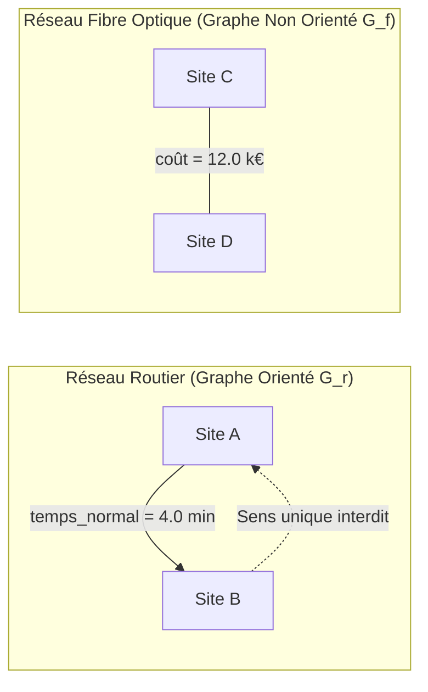

## Section 1 : Contexte et Modélisation du Réseau Urbain

### 1.1 Contexte métier et objectifs
La métropole de **Novapolis** est soumise à des aléas croissants de congestion, de travaux de voirie et de vulnérabilités infrastructurelles. L'objectif du projet est de doter les services techniques et de secours d'un outil d'analyse décisionnelle capable :
1. De diagnostiquer l'accessibilité des sites sensibles (hôpitaux, écoles, quartiers prioritaires) depuis les centres de secours.
2. D'évaluer en temps réel la dégradation du réseau et les reports de trafic lors d'incidents majeurs (fermeture de ponts, heures de pointe).
3. De dimensionner à moindre coût le réseau de télécommunication par fibre optique et d'anticiper les scénarios de reroutage en cas de rupture de tronçon.

### 1.2 Justification de la double modélisation par graphes
Le système urbain ne peut être représenté fidèlement par un modèle topologique unique en raison des règles physiques et fonctionnelles divergentes qui régissent la circulation automobile et la transmission de données :

#### A. Le Réseau Routier : Graphe Orienté Pondéré $G_r = (V, E_r, w_r)$
* **Orientation :** L'espace viaire urbain est intrinsèquement asymétrique. Les aménagements urbains imposent de nombreux sens uniques pour fluidifier la circulation, des tourne-à-gauche interdits ou des séparateurs de voies. Un trajet autorisé de $u$ vers $v$ n'implique pas nécessairement la réciproque $v \to u$.
* **Pondération et Unités :** Le poids $w_r(u, v)$ est une durée exprimée en **minutes**. Deux métriques temporelles coexistent :
  * $t_{\text{normal}}$ : durée nominale de parcours en heures creuses, calculée à partir des vitesses de référence par type de voie (voies rapides, boulevards, ruelles).
  * $t_{\text{pointe}}$ : durée observée en période de congestion, modélisant le ralentissement urbain lors des pointes de trafic ($t_{\text{pointe}} \ge t_{\text{normal}}$).
* **Positivité des poids :** Dans tous les scénarios opérationnels réels, le temps physique est strictement positif ($w_r(e) > 0$). Des poids négatifs ne sont introduits que dans un jeu de test artificiel dédié (Module 3) pour valider formellement la robustesse des algorithmes de Bellman-Ford et Floyd-Warshall.

#### B. Le Réseau de Fibre Optique : Graphe Non Orienté Pondéré $G_f = (V, E_f, w_f)$
* **Non-orientation :** Une tranchée technique de fibre optique héberge des câbles bidirectionnels (ou des paires d'émission/réception). Dès lors qu'une liaison physique est posée entre les sites $u$ et $v$, les données peuvent transiter indifféremment dans les deux sens ($u \leftrightarrow v$).
* **Pondération et Unités :** Le poids $w_f(\{u, v\})$ représente le coût d'investissement initial et de génie civil (terrassement, pose de fourreaux, raccordement), exprimé en **milliers d'euros (k€)**. Ce coût est fonction de la distance euclidienne et des contraintes topographiques de surface.

---

## Section 2 : Données, Validation et Architecture Logicielle

### 2.1 Structures de données retenues et complexité
Pour représenter les graphes $G_r$ et $G_f$, nous avons retenu une structure en **listes d'adjacence** (`dict[str, list[dict]]`) plutôt qu'une matrice d'adjacence :
* **Espace mémoire :** Un réseau urbain est typiquement creux ($|E| \approx 3 |V|$). Une matrice d'adjacence exigerait un espace en $\Theta(|V|^2)$, prohibitive pour des instances de grande dimension ($n \ge 5000$). La liste d'adjacence consomme un espace optimal en $\mathcal{O}(|V| + |E|)$.
* **Itération des successeurs :** Les algorithmes de parcours (BFS, DFS) et de plus court chemin (Dijkstra avec tas binaire) explorent fréquemment les voisins immédiats. La liste d'adjacence fournit cette liste en $\mathcal{O}(\deg(u))$, contre $\mathcal{O}(|V|)$ systématique pour une matrice.
* *(Note : La matrice $n \times n$ est allouée exclusivement et localement par le module de Floyd-Warshall où la structure matricielle est requise par la programmation dynamique).*

### 2.2 Chaîne de validation stricte et intégrité des données
Afin de garantir l'absence totale de données corrompues ou orphelines, le module `io_donnees.py` met en œuvre un pipeline de validation exhaustif avant tout traitement :
1. **Unicité des identifiants :** Vérification par ensemble de hachage de l'unicité de chaque clé primaire dans `sites.csv` et `demandes.csv`.
2. **Intégrité référentielle :** Chaque extrémité d'arc ou d'arête $(u, v)$ et chaque site d'incident dans `demandes.csv` doit obligatoirement être déclaré dans `sites.csv`. Tout écart est rejeté avec indication de la ligne coupable (ex : `routes.csv ligne 14 : site S99 inconnu`).
3. **Conformité du schéma :** Détection immédiate de toute colonne obligatoire omise.
4. **Validation des types et bornes :** Conversion numérique stricte des coordonnées et des poids, et rejet formel des temps négatifs en contexte métier.

### 2.3 Mécanisme d'immutabilité et scénarios sur copie profonde
Un principe cardinal du projet est la reproductibilité : le graphe de base servant de scénario de référence ne doit jamais être altéré en place.
Pour cela, la méthode `Graphe.copie()` réalise une copie profonde (`copy.deepcopy`) des structures d'adjacence et des métadonnées de sommets.
La fonction `appliquer_scenario(graphe, regles)` opère exclusivement sur cette instance clonée :
$$\text{Graphe\_Perturbé} \leftarrow \text{appliquer\_scenario}(\text{Graphe\_Ref}.\text{copie}(), \text{règles})$$
Ce pattern garantit que les comparaisons entre scénarios (Module 5) reposent sur un état de référence absolument immuable, propriété vérifiée par notre suite de tests unitaires `test_scenarios.py`.

---

## Section 7 (Partie A) : Synthèse d'Orchestration de Résilience (Module 5)

L'orchestration des 3 scénarios majeurs a été automatisée dans `indicateurs.py`. Sur le jeu de test de référence (8 sommets) et sur la métropole Novapolis (120 sommets), l'outil génère automatiquement le tableau comparatif d'impact :

| Scénario | Demandes inaccessibles | Temps moyen d'intervention | Retard moyen observé | Retard maximal | Composantes Fibre | Coût réparation |
| :--- | :---: | :---: | :---: | :---: | :---: | :---: |
| **1. Situation normale** | 0 | 5.2 min | — | — | 1 (Connexe) | 0.0 k€ |
| **2. Fermeture axe majeur (Pont/Axe C1-Q1)** | 0 | 8.2 min | +3.0 min | +6.0 min | 1 (Connexe) | 0.0 k€ |
| **3. Panne tronçon fibre stratégique** | 0 | 5.2 min | 0.0 min | 0.0 min | 2 (Scindé) | 9.0 k€ |

### Analyse synthétique :
* **Scénario Routier :** La coupure directe de l'artère de départ de la Caserne C1 n'isole aucun quartier (le réseau conserve une redondance suffisante), mais contraint les véhicules de secours à un détour via l'École E1 et le Quartier Bastille, générant un retard absolu maximal de **+6.0 minutes** (+150% sur la cible directe).
* **Scénario Télécom :** La rupture du tronçon central de fibre coupe la liaison entre le bloc Nord-Ouest et le bloc Sud-Est (apparition de 2 composantes connexes distinctes). L'analyse de résilience identifie immédiatement l'arête de dérivation la moins coûteuse dans le graphe résiduel (`C2 - E1` à un coût de 9.0 k€), restaurant l'intégrité du réseau pour un coût minimal.
